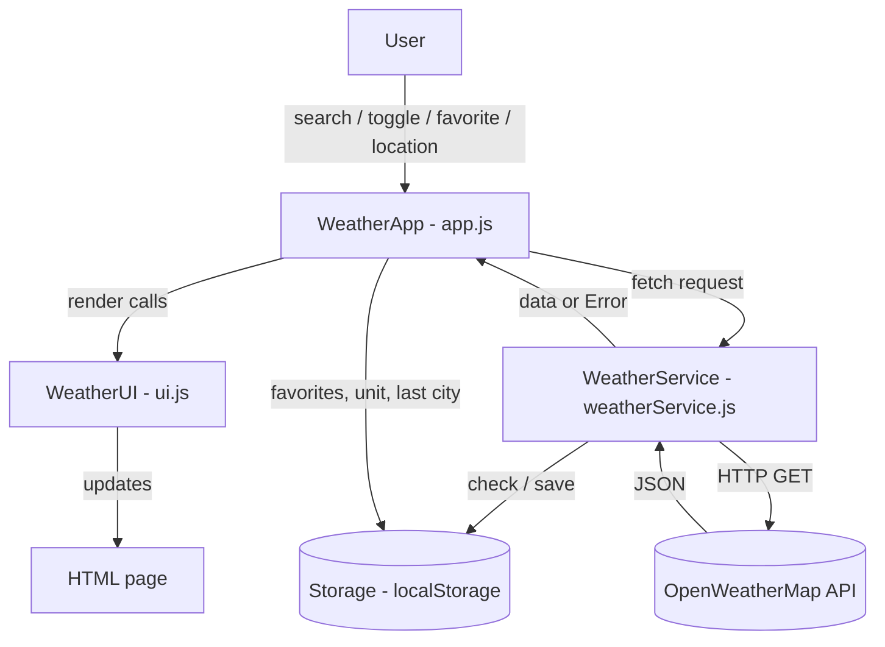
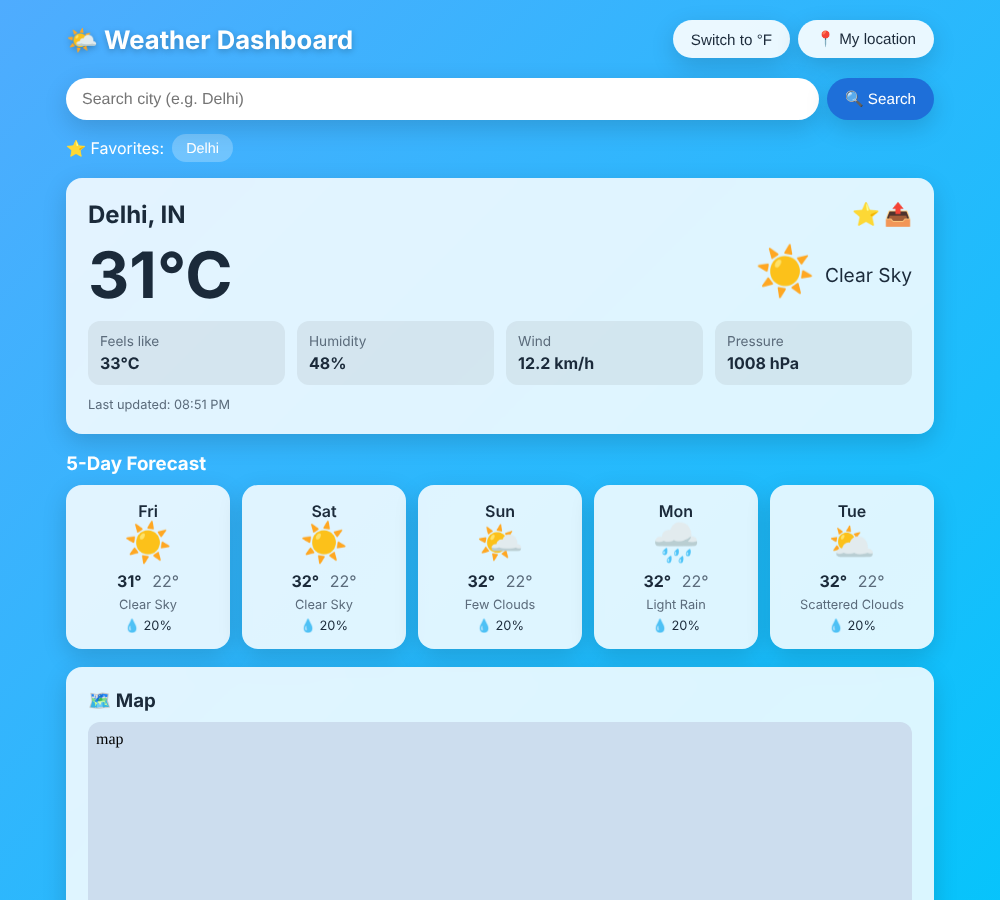
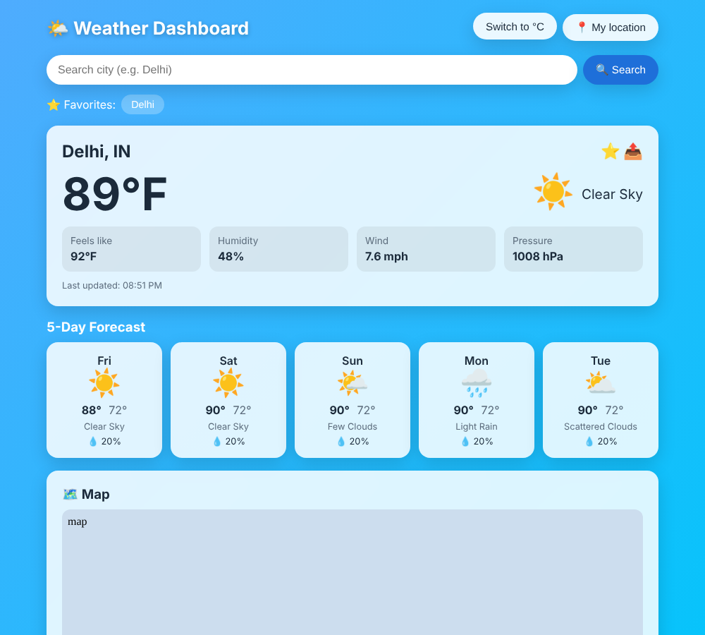
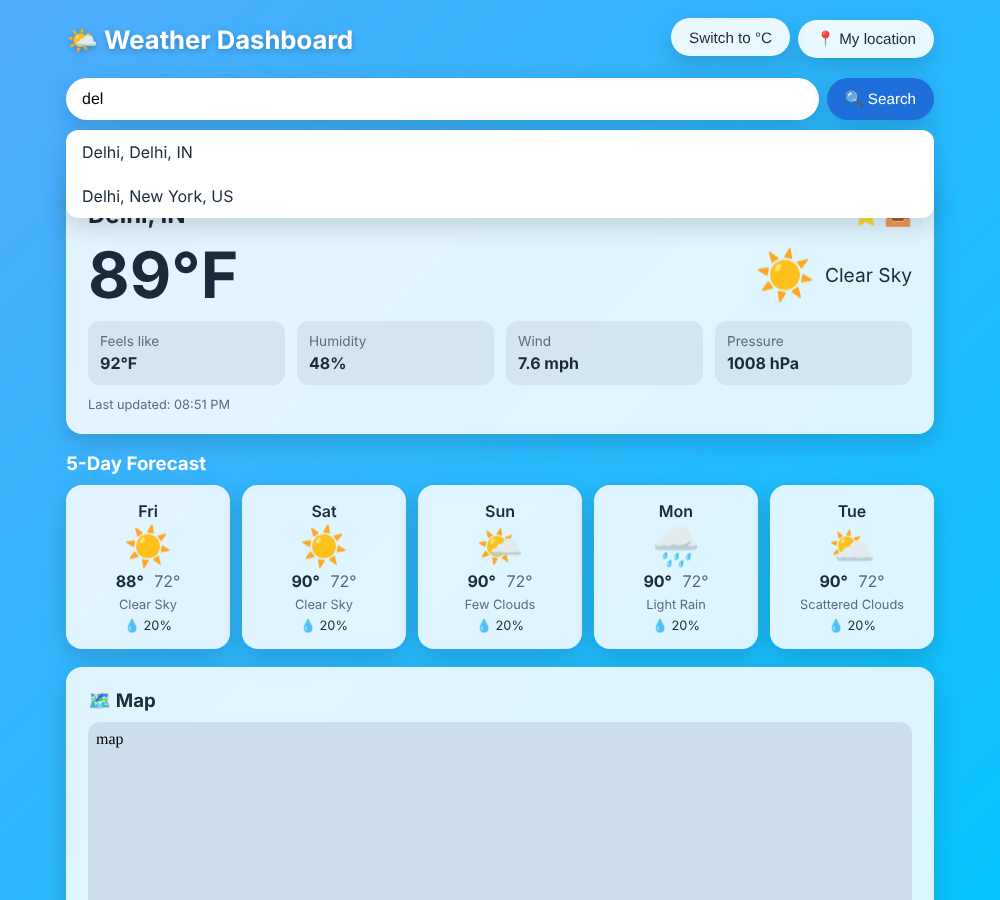
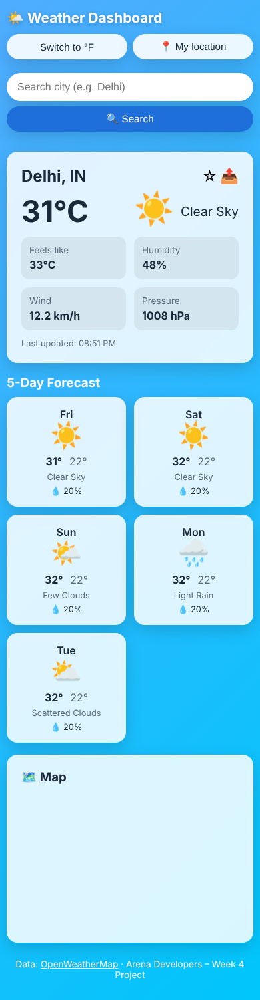
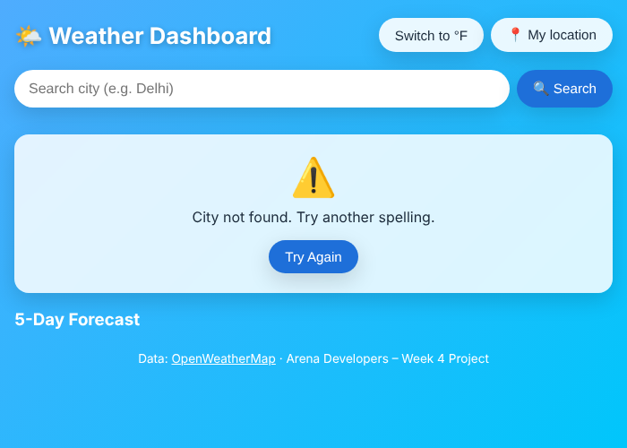

# 🌤️ Weather Dashboard – Week 4: Frontend Integration & Final Project

A responsive weather application that fetches real-time data from the **OpenWeatherMap API** and shows current conditions, a 5-day forecast, city search with autocomplete, °C/°F conversion, favorites, caching and error handling. Built with plain HTML, CSS and JavaScript (no frameworks).

> **Live demo:** `https://Md-Kaif534.github.io/week4-weather-app/` (after deploying to GitHub Pages)

---

## 1. Project Overview

**Goal:** connect a frontend to a public REST API, handle JSON data asynchronously (`async/await` + `fetch`), manage state in the browser, and deploy the result.

**Learning outcomes covered**
- REST API basics and HTTP methods (GET requests, query parameters, status codes)
- JSON parsing and transformation
- Async programming (`async/await`, promises, `Promise.all`)
- Error handling for API failures (timeouts, 401, 404, 429, network errors)
- Project structure with separation of concerns
- Deployment to GitHub Pages

## 2. Features

| Feature | Status |
|---|---|
| Current weather (temp, feels like, humidity, wind, pressure) | ✅ |
| 5-day forecast (daily min/max, condition, rain chance) | ✅ |
| City search with **autocomplete** (OpenWeather Geocoding API, debounced) | ✅ |
| Celsius / Fahrenheit toggle (instant, no extra API call) | ✅ |
| Responsive design (desktop / tablet / mobile) | ✅ |
| Error handling + retry button | ✅ |
| Loading state (spinner) | ✅ |
| Data caching with `localStorage` (10 min TTL) | ✅ |
| Favorite cities (stored in `localStorage`) | ✅ |
| Dark / light mode based on sunrise & sunset at the searched city | ✅ |
| Location detection (Geolocation API) | ✅ |
| Share (Web Share API, clipboard fallback) | ✅ |
| Map (OpenStreetMap embed) | ✅ |
| Weather warnings (derived from data: heat, freeze, wind, storm, heavy rain) | ✅ |

> Note: official government weather alerts need OpenWeather's paid One Call API, so warnings here are generated from the free-tier data.

## 3. Setup Instructions

1. **Get an API key** – sign up at <https://openweathermap.org/api> (free tier). New keys can take up to ~2 hours to activate.
2. **Clone the repo**
   ```bash
   git clone https://github.com/Md-Kaif534/week4-weather-app.git
   cd week4-weather-app
   ```
3. **Add your key** (choose one):
   - Open `index.html` and paste the key into the box that appears (saved only in your browser's `localStorage`), **or**
   - Put it in `js/config.js` → `API_KEY` for local use only. **Do not commit it.**
   - `.env.example` documents the variable name. Browsers cannot read `.env` files directly, so it is a reference file; `.env` itself is git-ignored.
4. **Run** – open `index.html` in a browser (or use `npx serve .`).
5. **Run the tests** (Node 18+): `node tests/test.js`

### Deploy to GitHub Pages
1. Push the repo to GitHub.
2. Repo → **Settings → Pages** → Source: *Deploy from a branch* → `main` / `/ (root)` → Save.
3. After a minute the site is live at `https://Md-Kaif534.github.io/week4-weather-app/`.
4. Open it and paste your API key into the setup box (kept in your browser only, so it is never in the repo).

## 4. Code Structure

```
week4-weather-app/
├── index.html              # page structure
├── css/
│   ├── style.css           # theme variables, layout, components
│   ├── weather-icons.css   # emoji icons + animation
│   └── responsive.css      # tablet / mobile breakpoints
├── js/
│   ├── config.js           # API URLs, cache duration, defaults
│   ├── storage.js          # localStorage wrapper (cache, favorites, settings)
│   ├── weatherService.js   # API calls, timeout, error mapping
│   ├── ui.js               # rendering only (no API calls)
│   └── app.js              # controller: events + wiring
├── tests/
│   ├── test.js             # unit tests (node tests/test.js)
│   └── test-output.txt     # recorded test run
├── screenshots/            # visual documentation
├── assets/{icons,images}/
├── README.md
├── .env.example
└── .gitignore
```

## 5. Technical Details

**Architecture:** layered, each file has one responsibility.
- `WeatherService` talks to the network only. `WeatherUI` renders only. `WeatherApp` connects them. `Storage` hides `localStorage`.

**Key algorithms / techniques**
- **Caching:** each response is stored under `cache_<type>_<city>` with a timestamp; entries older than 10 minutes are discarded. This reduces API calls and respects free-tier rate limits.
- **Parallel requests:** current weather and forecast are fetched together with `Promise.all`.
- **Forecast grouping:** OpenWeather returns 40 items (every 3 h). They are grouped by calendar day (`Map`-like object keyed by `toDateString()`); min/max are computed over the day and the icon/description is taken from the reading closest to 12:00.
- **Unit conversion:** data is always stored in metric. `°F = °C × 9/5 + 32`; wind m/s → km/h (×3.6) or mph (×2.237). Toggling re-renders from stored data without a new request.
- **Autocomplete:** input is debounced (350 ms) before calling the Geocoding API to avoid a request per keystroke.
- **Timeout & errors:** `AbortController` cancels requests after 10 s; HTTP status codes are mapped to friendly messages.
- **Security:** all API text is escaped before being inserted with `innerHTML` (XSS protection); the API key is not committed.
- **Theme:** `night` class is toggled when the city's current time is outside sunrise–sunset.

**Data structures:** objects for cache entries, arrays for favorites (max 8), `localStorage` key/value for settings.

**API endpoints used (GET)**
| Purpose | Endpoint |
|---|---|
| Current weather | `/data/2.5/weather?q={city}&units=metric&appid=KEY` |
| 5-day forecast | `/data/2.5/forecast?q={city}&units=metric&appid=KEY` |
| By coordinates | `.../weather?lat=&lon=` and `.../forecast?lat=&lon=` |
| Autocomplete | `/geo/1.0/direct?q={text}&limit=5&appid=KEY` |

## 6. Component Architecture



**Data flow:** User action → `WeatherApp` → `WeatherService` (cache check → API) → JSON → `WeatherApp` → `WeatherUI` → DOM.

ASCII version:
```
User ─► WeatherApp ─► WeatherService ─► [cache?] ─► OpenWeatherMap API
            │                │                              │
            │◄───── JSON / Error ◄──────────────────────────┘
            ▼
        WeatherUI ─► DOM
```

## 7. Visual Documentation

> Screenshots were captured with an automated browser using **mocked API responses** (sample data for Delhi), so the numbers are illustrative. Replace them with screenshots from your own run with a real API key if your instructor wants live data.

| Desktop (°C) | Desktop (°F) |
|---|---|
|  |  |

| City autocomplete | Mobile |
|---|---|
|  |  |

| Error state |
|---|
|  |

## 8. Testing Evidence

**Automated unit tests** – `node tests/test.js` → **21 passed, 0 failed** (full output in `tests/test-output.txt`).

| Area | Test cases |
|---|---|
| Temperature | 0°C→32°F, 100°C→212°F, −40°C→−40°F, rounding |
| Wind | 10 m/s → 36.0 km/h and 22.4 mph |
| Icons | thunderstorm, clear day/night, rain |
| Forecast | 16 three-hour items grouped into 2 days, correct min/max |
| Security | HTML escaping of `<b>` |
| Storage | add/remove favorite, max 8 favorites, cache hit, cache expiry |
| Errors | 401, 404, 429 map to correct messages |

**Manual test cases**

| # | Scenario | Expected | Result |
|---|---|---|---|
| 1 | Search "Delhi" | Current weather + 5 forecast cards | ✅ (mocked API) |
| 2 | Click unit toggle | Values switch °C↔°F, no new request | ✅ |
| 3 | Type "del" | Suggestions list appears | ✅ |
| 4 | API returns 404 | Error card with "Try Again" | ✅ |
| 5 | Resize to 390 px | Layout switches to 2-column forecast | ✅ |
| 6 | Click ☆ | City added to favorites chips, persists on reload | ✅ |
| 7 | Search same city within 10 min | Served from cache | ✅ (logic unit-tested) |

> Manual tests above were run against mocked API responses. Test once with your real key before submitting.

## 9. API Used

**OpenWeatherMap** – free tier provides current weather, 5-day / 3-hour forecast and geocoding. <https://openweathermap.org/api>

## 10. Future Improvements
- Hourly chart, air-quality index
- Service worker for offline support
- Official weather alerts (One Call API)

## Author
Arena Developers – Week 4 submission
